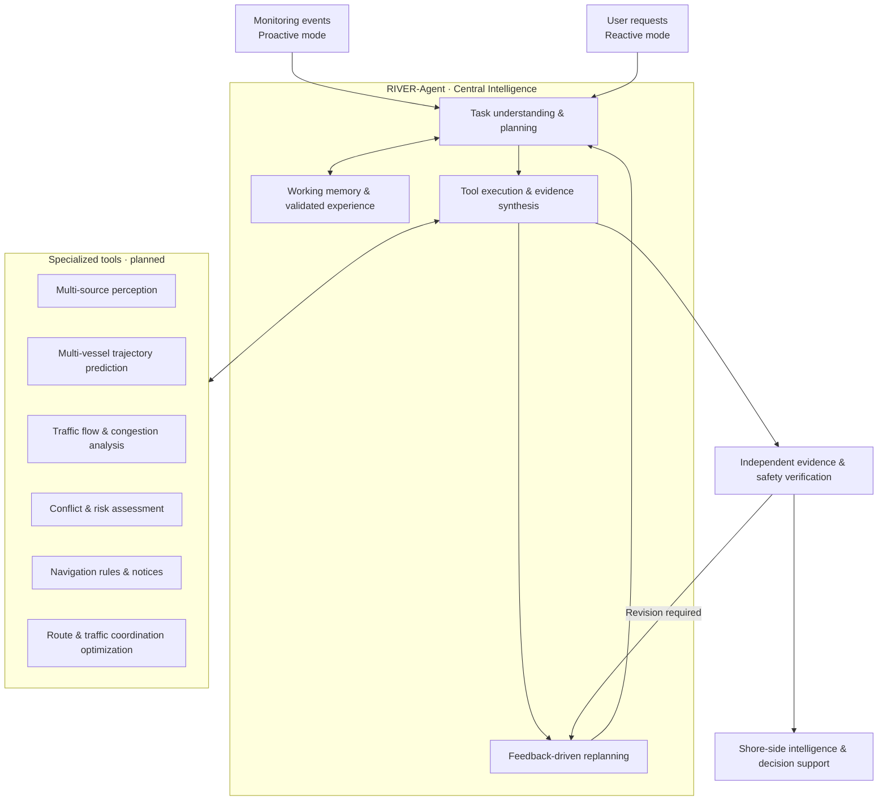

# RIVER-Agent

[English](README.md) | [简体中文](readme-zh.md)

### A Shore-side AI Agent for Inland Waterway Intelligence

**Reliable Inland Vessel Evidence-based Reasoning**

*Perception · Prediction · Assessment · Service · Coordination*

[Overview](#overview) · [Architecture](#architecture) · [Planned Capabilities](#planned-capabilities) · [Roadmap](#roadmap) · [Project Status](#project-status)

> [!NOTE]
> **Project status: early development.** This repository is being initialized. The architecture and capabilities below describe the planned research scope; they are **not** claims of completed implementations or validated performance.

## Overview

**RIVER-Agent** is a research project exploring a unified, shore-side AI agent for inland waterway traffic intelligence and navigation decision support.

The project aims to bring together vessel observations, waterway information, traffic prediction, risk assessment, and domain-specific tools. A **single central agent** will plan analyses, invoke specialized tools, check supporting evidence, and provide traceable results for vessel services and regional traffic management.

## Design Principles

- **One central agent:** A unified planning and reasoning agent, supported by specialized tools rather than multiple independent LLM agents.
- **Proactive and reactive:** Support both monitoring-event triggers and user-initiated requests.
- **Plan → Execute → Verify → Replan:** Adapt tool selection and analysis steps to the task and available evidence.
- **Grounded decisions:** Separate numerical prediction, risk computation, and safety checks from language-model reasoning.
- **Bounded autonomy:** Apply execution limits, failure handling, and human oversight to safety-relevant recommendations.
- **Traceable context:** Maintain task working memory and reuse historical cases only when appropriately validated.

## Architecture

The central agent is responsible for orchestration and reasoning. Observation processing, forecasting, risk computation, optimization, and safety verification remain independently testable components.

## Planned Capabilities

| Area | Intended capabilities |
| --- | --- |
| **Traffic perception** | Integrate AIS, shore radar, BeiDou/GNSS, hydro-meteorological observations, and waterway infrastructure status as data access permits. |
| **Vessel prediction** | Model short-term trajectories and interactions among multiple vessels. |
| **Traffic evolution** | Analyze vessel traffic flow, congestion, and conditions at critical sections and complex reaches. |
| **Risk assessment** | Detect potential conflicts, anomalous behavior, and navigation risks with explicit computational evidence. |
| **Navigation knowledge** | Retrieve applicable navigation rules, notices, restrictions, and their spatial and temporal validity. |
| **Navigation services** | Support vessel-specific risk information, route recommendations, and regional traffic coordination advice. |

### Initial End-to-End Scenario

> Analyze potential multi-vessel conflicts in a specified inland waterway area over the next five minutes, identify the supporting observations and prediction results, check applicable navigation restrictions, and return an evidence-backed risk assessment.

The initial prototype will prioritize **AIS access, waterway context, trajectory analysis, risk computation, and verifiable responses**. Other data sources and optimization capabilities will be integrated incrementally.

## Roadmap

- [ ] **Phase 1 — Agent Core:** Task understanding, dynamic planning, tool interfaces, execution state, memory, verification, and recovery.
- [ ] **Phase 2 — Maritime Intelligence:** Multi-source perception, multi-vessel trajectory prediction, traffic-flow analysis, risk assessment, and navigation knowledge.
- [ ] **Phase 3 — Shore-side Services:** Proactive monitoring, individual vessel services, route and traffic coordination support, and representative-waterway evaluation.
- [ ] **Research evaluation:** Reproducible task benchmarks, controlled baselines, robustness analysis, and empirical assessment as capabilities become available.

## Scope & Safety

RIVER-Agent is designed for **research and shore-side decision support**. It does not replace qualified vessel operators or maritime authorities, and does not autonomously issue binding traffic-control instructions or directly control vessels. Safety-critical alerts should not depend solely on an LLM response.

## Project Status

The project is at the **architecture and initial development** stage. Installation instructions, executable examples, datasets, benchmark results, publications, and release information will be added when available and verified.
