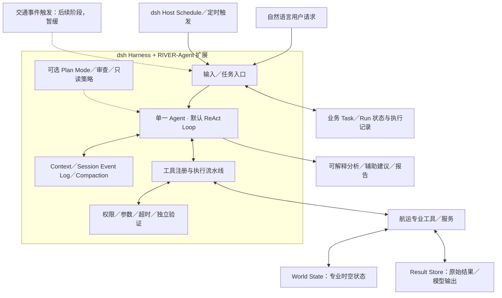

# RIVER-Agent：Agent Core 架构设计（第 03 阶段）

> 版本：v0.1（架构讨论归档）  
> 日期：2026-11-09  
> 状态：**第 03 阶段架构原则已讨论确定；尚未开发、集成或实验验证**  
> 开发主线：**DeepSeek Harness（dsh）为底座；Codex 仅作部分技术参考**  
> 关联：[讨论路线图](DISCUSSION_ROADMAP.md) · [任务／能力／工具目录](TASK_CAPABILITY_TOOL_CATALOG.md)

## 1. 设计目标与边界

RIVER-Agent 是用于内河航运岸基服务的**单一中央智能体**。负责理解自然语言目标、决定工具调用、汇集证据、解释结果以及管理有限自主执行。AIS 数据处理、多源融合、轨迹与交通流预测、风险计算、规则核查和优化由独立专业服务承担；专业服务不是其他 LLM Agent。

以**复用 dsh 通用 Agent Harness**为原则，不重复开发 Agent Loop、工具执行流水线、Session Event Log、会话持久化、上下文压缩等底层能力。通过 Cordis 插件、工具和专业服务形成航运领域扩展。实施前须核实选定 dsh 版本、许可证及具体接口。

**安全边界**：不自动控制实船，不将模型输出视为具有约束力的通航指令。基础安全监测/时效敏感预警不依赖 LLM 持续在线；具有外部副作用或高风险的行动须受独立权限和人工审核机制约束。

## 2. 逻辑架构



这是一张**职责示意图**，不是当前已运行的服务部署图，也不意味着每个方框必须独立部署。

### 2.1 复用与自研边界

| 组件 | 优先方案 | 说明 |
| --- | --- | --- |
| Agent Loop / LLM 接口 | 复用 dsh | 保持 ReAct 式观察—行动迭代；不另造第二套主循环 |
| Tool Registry / Executor | 复用 dsh | 借助 `ToolDefinition`、Schema、工具执行 Hooks；必要时实现工具发现/选择层 |
| Session / Persistence | 复用 dsh | 事件日志与持久化作为会话事实记录；不直接当作航运事实库 |
| Context / Compaction | 复用 dsh | 上下文压缩与按需摘要；领域数据通过引用取回 |
| Plan Mode | 基于 dsh 扩展 | 保留模式切换与计划审查；**只读由 Runtime 权限策略强制执行**，不能只依赖模型提示 |
| 定时任务 | 优先复用 dsh Host Schedule | 调度只负责定时投递，业务执行完成情况须额外追踪 |
| Task / Run 业务状态 | 必要时做轻量扩展 | 存放长期目标、每次执行身份、进度、状态与结果引用；不与 dsh Turn 混同 |
| World State | **RIVER-Agent 专业组件** | AIS／环境／航道等时空态势；具体实现保留第 05 阶段 |
| Result Store | RIVER-Agent 专业组件或共享存储 | 保存高容量轨迹、预测、图表和数值结果，供工具间直接引用 |
| 领域验证 | RIVER-Agent 扩展 | 数据时间、权限、质量、规则、结果适用性与外部行动的独立检查 |
| 领域工具与模型 | RIVER-Agent 集成／研发 | AIS、流量预测、多船预测、冲突分析、航行通告等 |

**Codex 角色**：仅参考可借鉴的运行时、工具处理和上下文设计；不开发 dsh/Codex 双兼容框架。

## 3. 运行范式与模式

### 3.1 默认 ReAct

不要求每次任务先生成完整计划。一个执行轮次由模型根据目标、上下文和最新工具观察决定后续行动：查询／计算工具、补充信息、按需规划、结束或升级处理。反思仅在结果异常、证据矛盾或失败时按需发生，**不单独构建 Reflection Agent**。

```text
用户请求／定时投递
  -> 形成执行上下文
  -> dsh Agent Loop：模型判断下一步
       -> 按需查询／调用工具
       -> Tool Executor 验证参数、权限、执行与结果
       -> 更新 Session 与业务状态、返回简洁 Observation
       -> 必要时追查、纠错、验证或继续
  -> 有效证据支持的结果／有条件结论／停止并转人工
```

`PLAN`、`CALL_TOOL`、`REQUEST_INFO`、`FINALIZE`、`ESCALATE` 只是用于理解动作边界的**概念语义**，不是声称 dsh 已实现的 API 名称。

### 3.2 可选 Plan Mode

Plan Mode 是工作模式，Plan 是持久化的目标、子任务和依赖表示；二者应区分。复杂、长期或需要用户审查的任务可进入规划模式，查询可用资源和约束、提出计划并申请确认。审批通过后返回共用 ReAct Runtime 执行，不另建 Plan Executor。

**规划阶段默认强制只读**：允许授权的查询、分析及无副作用模拟；禁止更改外部业务状态、向第三方正式发送通知等动作。dsh 原生 Plan Mode 的提示性约束与实际权限控制须分别核实；RIVER-Agent 要在工具执行前的策略层实施真正限制。计划变化如影响任务目标、权限或安全边界，需重新审查。

## 4. Tool System 与结果管理

- **注册与发现**：基础核心工具保持可用；大量专业工具通过描述和发现机制按需提供，不在任务开始时用固定类别排除所有其他工具。具体 Tool Discovery 接口须基于 dsh 选定版本验证。
- **工具 Schema**：按 dsh `ToolDefinition` 机制定义名称、输入、输出和执行函数；工具侧校验参数、规范化错误、声明超时与并发安全条件。
- **并行执行**：同一模型步骤中无数据依赖且经工具明确声明并发安全的调用可并行；依赖前序结果、存在共享状态写入冲突或存在外部副作用的操作优先串行。dsh 的 `isConcurrencySafe` 等现有约束可作为实现依据。
- **独立验证**：前置校验权限、范围、参数、授权及外部影响；后置校验数据质量、时效、规则适用性、结果一致性。LLM 自检不能代替确定性校验。
- **大结果外置**：AIS 轨迹、多船预测、密集数值和大图数据进入 Result Store。模型只获得经过约束的摘要、来源、时效、质量和 `result_ref`；后续专业工具通过引用直接读取数据，避免 LLM 转写高精度数值。
- **权限和引用**：`result_ref` 访问要关联授权、数据版本和有效期；原始结果不能因为被压缩进 Context 而失去审计能力。

## 5. Session、Task、Run 与状态分层

### 5.1 生命周期概念

| 对象 | 含义 | 设计要求 |
| --- | --- | --- |
| `Session` | Agent 会话与交互事件流 | 复用 dsh 事件日志与持久化 |
| `Task` | 业务目标，可以长期存在 | 保存目标、调度、区域、权限、结果索引 |
| `Run` | Task 的某次实际 Agent 执行 | 保存本次触发、执行状态、结果和失败原因 |
| `Turn / Step` | dsh Agent Loop 内的会话与模型调用单位 | 不与 RIVER-Agent 业务 Run 强行一一对应 |

建议长期定时 Task 的每次 Run **优先使用独立 Session**，仅加载必要的任务配置、前次有效摘要和最新可用的 World State；但 Session 复用策略在实际集成前仍需确认，不锁死实现。

### 5.2 数据与记忆分层

| 层 | 核心职责 |
| --- | --- |
| Context | 本轮送入模型的必要指令、工具 Schema、近期消息与摘要 |
| Session Event Log | 记录会话中发生的可持久化事件，支持追踪与恢复 |
| Task State / Run State | 业务任务目标、执行状态、授权、进度与结果关联 |
| World State | 航运实体、观测、态势及其时空关系；不是 LLM 聊天记忆 |
| Result Store | 大体量、可复用的原始数据与模型产物 |
| Long-term Memory | 可追溯、经核验的历史案例与经验；初期可轻量或暂不启用 |
| Knowledge Base | 规则、通告和专业知识的权威来源与适用条件，不混入主观经验记忆 |

**World State 明确保留后续专题**：研究船舶/航段/设施数据模型，观测时间、进入系统可用时间和预测有效时间；来源、质量、版本、一致性、延迟修正、历史回放及 Agent 查询接口。历史分析不得读取在当时尚未可获得的未来数据。**当前不选数据库、消息队列、时空 Schema 或融合算法。**

## 6. 执行控制、恢复与停止条件

尽量通过 dsh 原有执行、会话、权限和工具 Hooks 扩展，不另起完整执行引擎。

1. **预算与边界**：控制步数、Token/费用、工具超时、权限和取消；满足目标且验证通过可完成；数据不足时给出有条件结果；不具备授权时停止或转人工。
2. **错误分类**：模型请求异常、工具失败、环境数据过期、外部操作状态未知应区分处理，而非统一让模型无限重试。
3. **重启恢复**：读取 dsh Session Event Log 与业务 Run State，核实哪些操作实际完成；可安全重试的只读/计算工具可以复用结果或重新调用。
4. **外部副作用**：创建任务、修改配置、发送通知需唯一操作标识、权限检查和幂等保护；响应超时不能默认“未执行”后直接重复。
5. **结果时效**：即使从中断点恢复，也需要重新验证之前 AIS／预测结果对当前交通态势是否有效。

**重要事实**：dsh Host Schedule 的 delivery receipt 证明指令已经持久化投递至目标 Session，**不代表 Agent 已完成业务分析**。因此，RIVER-Agent 需要独立 Run 结果状态；还要防范两份持久化之间故障造成的重复投递。

## 7. 主动运行：首期仅定时任务

### 7.1 首期范围

支持用户提出“每天 08:00 分析某航段交通状况”等任务意图。定时器保存规则和目标，会话被触发后使用统一 ReAct Runtime 执行，必要时读取最新 World State。优先复用 dsh **Host Schedule**，它提供 `after`、`at`、`every`、`daily`、`weekly`、`cron`、`rrule` 及多种 Session 目标。

**事件触发（Event Monitor / Event Trigger）暂缓开发**。这只是首期范围调整；“主动 + 被动融合”的长期目标不变。基础安全监测能力如需部署，应独立于 LLM 执行。

### 7.2 明确尚未决定的事项

- **定时任务重叠执行：未定。** “同一 Task 最多一个运行中的 Run，重叠 Skip”只是临时候选；Queue／Parallel／Replace 仍需结合耗时、资源和时效性重新讨论。
- **定时 Session 复用：建议每次独立 Session，待实际测试。**
- Host 停机后的漏执行处理、独立业务 Run 成功/失败确认、重试与重复投递、通知渠道授权等，均须实施前明确。
- 不因已决定使用 dsh 而自动接受其所有默认业务策略。

## 8. 第一阶段可运行切片（建议，非功能承诺）

选取一个**数据和工具真正可用**的低风险场景，形成最小闭环：

```text
用户询问指定航段在指定时段的交通情况
  -> 解析航段与时间
  -> 查询可用 AIS／交通统计
  -> 工具校验质量、来源和时间范围
  -> 保存完整数据／结果引用
  -> Agent 形成有证据支持的解释
  -> 输出结论和数据局限
```

首先验证 dsh 插件注册、工具调用、Session 重启恢复、Context 引用、证据校验与终止行为，再逐步加入独立专业预测工具及定时任务。**不能将尚未取得的船舶级高频 AIS、多船预测模型或风险评估工具当作已有能力。**

## 9. 决策状态与交接

| 主题 | 状态 | 后续归属 |
| --- | --- | --- |
| dsh 主底座、Codex 部分参考 | **已确定** | 第 06 阶段验证版本与接入 |
| 单 Central Agent、默认 ReAct | **已确定** | 第 06 阶段工程集成 |
| Plan Mode 可选且强制只读 | **已确定原则** | 实施前验证权限强制机制 |
| 工具按需发现、验证、大结果外置 | **已确定原则** | 第 04 阶段工具契约；第 06 阶段接入 |
| Context／Session／Task／World State 分层 | **已确定逻辑边界** | 第 05 阶段细化 World State |
| 定时任务优先、事件触发暂缓 | **已确定阶段范围** | 第 06 阶段实现 |
| 每次定时 Run 用独立 Session | **建议，待验证** | dsh 集成测试 |
| 重叠任务默认 Skip | **暂定，尚未想清楚** | 工程实现前重新讨论 |
| 业务状态 Schema、通知幂等、存储选型 | **待细化** | 第 04／05／06 阶段 |
| 研究有效性与 Benchmark | **后续** | 第 07 阶段 |

**第 03 阶段结论**：统一中央 Agent 依托 dsh Harness，通过可选 Plan Mode、领域工具、独立验证、分层状态和首期定时任务构成完整的**逻辑设计**；此阶段的完成不代表接口落地、数据接通或实验验证完成。

**下一阶段**：复核现有 [13 类任务、23 项能力、24 个工具](TASK_CAPABILITY_TOOL_CATALOG.md)，首先删除首期不实施的事件触发依赖、对齐 dsh 工具接口和权限/输出契约，再确定可实际搭建的最小工具集。

## 10. dsh 官方源码／设计资料

- [Architecture：Cordis、Profiles、Core 与 Agent Loop](https://github.com/deepseek-ai/deepseek-harness/blob/master/docs/architecture.md)
- [Agent Core 与 Agent Loop](https://github.com/deepseek-ai/deepseek-harness/blob/master/docs/subsystems/core.md)
- [Tools：ToolDefinition、Schema、并发与执行](https://github.com/deepseek-ai/deepseek-harness/blob/master/docs/subsystems/tools.md)
- [Session：Event Sourcing](https://github.com/deepseek-ai/deepseek-harness/blob/master/docs/subsystems/session.md)
- [Persistence：持久化与恢复](https://github.com/deepseek-ai/deepseek-harness/blob/master/docs/subsystems/persistence.md)
- [Compaction：上下文压缩](https://github.com/deepseek-ai/deepseek-harness/blob/master/docs/subsystems/compaction.md)
- [Schedule：Host 级定时任务](https://github.com/deepseek-ai/deepseek-harness/blob/master/docs/subsystems/schedule.md)

以上为 2026-11-09 讨论时参照的仓库文档。具体包、接口、行为应以后续锁定的源码版本为准。
