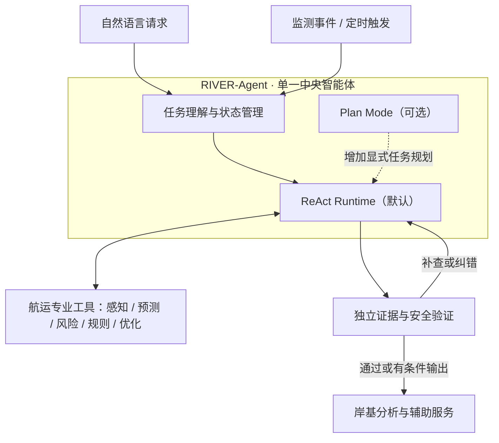

# RIVER-Agent：阶段讨论路线图与决策记录

> **用途**：记录项目讨论进度、已达成的设计共识、待解决的问题和阶段交付物。  
> **维护方式**：每完成一个阶段的讨论，更新本文件并提交至 GitHub `main` 分支。  
> **最近更新**：2026-11-09  
> **状态说明**：本文记录的是**方案讨论进展**，不代表软件功能已经实现或通过验证。

## 1. 当前进度

**当前主线：第 3 阶段——Agent Core 详细设计。**

总体路线：**目标与需求 → 总体架构 → Agent Core → 任务/能力/工具体系 → 数据与专业模型 → 系统实现 → Benchmark 与科研验证**。

| 阶段 | 主题 | 讨论状态 | 主要产出 |
| --- | --- | --- | --- |
| **01** | 项目定位与需求分析 | ✅ 已确定 | 项目目标、三项建设内容、五个关键问题、系统边界 |
| **02** | 总体技术架构 | ✅ 已确定 | 统一中央 Agent、主动与被动融合、专业工具及独立验证 |
| **03** | Agent Core 详细设计 | 🔄 进行中 | ReAct 默认框架、可选 Plan Mode、执行循环；Runtime 细节待讨论 |
| **04** | 任务、原子能力与工具体系 | 📝 已形成专题讨论稿，待阶段归档 | 任务—能力—工具映射、示例执行链 |
| **05** | 数据与专业模型设计 | ⏳ 待系统讨论 | 数据接口、多源融合、轨迹/交通流预测、风险和优化 |
| **06** | 系统实现与岸基服务 | ⏳ 待系统讨论 | 后端、交互前端、监测调度、集成与场景运行 |
| **07** | Benchmark 与科研验证 | ⏳ 待系统讨论 | 数据划分、实验任务、对照基线、消融及真实场景评估 |

> **说明**：第 04 阶段已有独立的设计文档，但不等于该阶段已完成最终评审；第 05–07 阶段此前虽有方向性讨论，尚未完成系统设计。

## 2. 已完成阶段

### 阶段 01：项目定位与需求分析

**状态：已确定（讨论层面）**

**项目定位**

RIVER-Agent（Reliable Inland Vessel Evidence-based Reasoning）是一个以岸基服务为目标的内河航运智能体研究项目。通过融合交通感知、轨迹与交通流预测、风险评估、规则知识和辅助决策工具，为船舶提供个性化航行服务，为管理部门提供区域交通分析与协同引导支持。

**已确定的三项总体建设内容**

1. **岸基全域态势感知**：融合 AIS、岸基雷达、北斗/GNSS、水文气象、航道及桥区/船闸通航信息等。
2. **多船协同预测与态势演化**：研究多船交互轨迹预测、关键断面/航段交通流预测与交通状态演化。
3. **岸基智能航行服务**：支持冲突识别、风险预警、航路推荐、通航秩序评估和交通组织辅助决策。

**拟解决的五类关键问题**

1. 多源岸基监测与船岸协同信息融合感知。
2. 区域多船轨迹预测与交通态势演化分析。
3. 航路推荐、风险预警与协同引导。
4. “感知—预测—评估—服务—协同”一体化架构及工程实现。
5. 典型内河航段示范应用与推广。

**范围边界**

- 目标是**岸基智能分析与决策支持**，不直接控制实船。
- 初期可优先使用可获取的 AIS 与航道信息，其他数据源随实际条件逐步接入。
- 不要求第一个原型同时完成船闸调度优化、泊位优化或完整区域交通组织系统。

**阶段结论**：以总体建设要求作为项目顶层需求，分阶段建设研究原型。

### 阶段 02：总体技术架构

**状态：已确定（讨论层面）**

| 设计维度 | 已确定原则 |
| --- | --- |
| Agent 组织形式 | **一个统一的 Central Agent**；专业模块作为工具，不另建多个 LLM Agent。 |
| 运行模式 | **主动 + 被动融合**：交通监测/事件触发与自然语言请求均可启动任务。 |
| 专业能力 | 多源感知、多船轨迹预测、交通流与拥堵预测、风险评估、航运规则知识、航路与交通组织优化。 |
| 核心职责 | 中央 Agent 理解任务、组织推理、选择工具、整合证据、管理状态和反馈。 |
| 可信性 | 专业算法进行定量计算；独立验证器检查证据、时效、约束与输出适用性。 |
| 安全边界 | 时间敏感的基础预警不依赖 LLM；涉及航行指挥的高风险建议保留人工审核。 |
| 开发优先级 | **先做好 Agent 的实际能力，再进行完整 Benchmark 与论文实验**。 |

**总体结构**



**阶段结论**：以统一中央 Agent 为核心，组合主动/被动任务入口、专业工具及独立验证体系。

## 3. 当前阶段：Agent Core 详细设计

### 3.1 已确定的设计决策

| 主题 | 当前决定 |
| --- | --- |
| **默认范式** | **ReAct**：观察反馈与工具行动交替进行，不要求任务开始时必须生成完整计划。 |
| **可选模式** | **Plan Mode**：复杂、多阶段或长期任务按需启用显式计划管理，仍复用 ReAct 执行内核。 |
| **工具调用** | 使用结构化 Function Calling 调用专业数据与计算工具。 |
| **纠错** | Reflection 作为**按需触发的纠错机制**，而非独立 Agent 或所有任务都必经的模式。 |
| **验证** | 核心证据与安全规则由独立模块检验，不能仅依赖 LLM 自我反思。 |
| **记忆** | 工作记忆维护当前任务状态；长期经验仅保存经过核验、可追溯的案例。 |
| **自主边界** | 限制工具权限、执行预算、重试和时长；失败可明确终止或请求人工处理。 |

**关键修订记录**：此前曾讨论以“Plan–Execute–Verify–Replan”描述总体执行机制；后续明确了**ReAct 是默认 Runtime，Plan 是可选 Mode**。因此，“每个任务必须先生成计划”**不再是当前设计要求**。

### 3.2 初步执行循环（原则已讨论，尚未定稿）

```text
任务输入（用户 / 事件）
    ↓
解析目标与当前状态
    ↓
ReAct：选择下一步行动
    ├─ 调用专业工具 → 观察结果 → 更新状态 ─┐
    ├─ 请求缺失信息                      │
    ├─ 必要时进入 / 更新 Plan Mode       │
    ├─ 触发纠错或独立验证 ────────────────┘
    └─ 满足条件时完成 / 降级 / 终止
```

**已讨论的 Agent 动作类型（初稿）**

- `PLAN`：创建、修改局部或完整任务计划，仅在需要时使用。
- `CALL_TOOL`：使用经过注册和授权的专业工具。
- `REQUEST_INFO`：获取无法通过现有工具解决的必要信息。
- `FINALIZE`：生成有证据支持的结果，明确结论和适用边界。
- `ESCALATE`：证据不足、权限不足或存在高风险时停止或转人工。

这些是**待细化的内部动作语义**，不是已经实现的 API。

### 3.3 当前待讨论清单

- [ ] **ReAct Runtime**：模型调用、工具调用、观察结果、下一轮决策的具体执行协议。
- [ ] **Task State**：任务状态 Schema、消息与证据的关系、任务生命周期及持久化。
- [ ] **Context & Memory**：上下文窗口管理、交通态势缓存、短期记忆和长期经验更新规则。
- [ ] **Tool System**：工具注册、发现、权限、参数校验、超时、错误规范及结构化返回。
- [ ] **Plan Mode**：显式计划的数据结构、激活方式、计划与 ReAct 的关系、步骤进度和重规划。
- [ ] **Verification & Recovery**：独立验证器的介入点、失败分类、重试/回退和完成条件。
- [ ] **主动运行接口**：定时任务和事件任务如何进入同一 Runtime，且不让 LLM 承担持续高频监听。

**本阶段完成标准**：形成一致的 Agent Runtime 设计，明确状态、事件/动作、工具协议、Mode 关系、停止条件和最小可运行场景；完成文档归档后，将本阶段改为“✅ 已确定”。

## 4. 后续阶段讨论范围

### 阶段 04：任务、原子能力与工具体系

现有专题草案：[`docs/TASK_CAPABILITY_TOOL_CATALOG.md`](TASK_CAPABILITY_TOOL_CATALOG.md)。

该文档已记录 **13 类任务（K01–K13）、23 项原子能力（C01–C23）、24 个逻辑工具（T01–T24）**，以及任务—能力—工具映射和执行案例；均属于设计方案，不表示功能已上线。

本阶段后续需要与 Agent Core 的 Runtime 和 Mode 约定核对一致，确认最小必备工具、任务优先级与具体场景，然后正式归档。

### 阶段 05：数据与专业模型

讨论多源 AIS/雷达/北斗/GNSS/水文和航道信息，质量处理与时空关联；船舶级短时多船轨迹预测；航段级交通流和拥堵预测；CPA/TCPA 与风险计算；航行通告时空有效性；航路和交通组织优化。**必须区分已有研究基础、计划研发能力与已接通数据源。**

### 阶段 06：系统实现与岸基服务

讨论后端组件、前端交互（对话入口、任务发起、地图与可解释结果）、主动调度和持续监测、权限和日志、真实任务集成；明确 MVP 与扩展边界。

### 阶段 07：Benchmark 与科研验证

讨论可复现的时空任务、时间隔离的历史回放、固定工作流/规则基线/通用 Agent 等对照、性能与安全指标，以及候选研究机制。**不在实现之前预设效果或论文结论。**

## 5. 更新规则

后续以**本文件作为阶段讨论的唯一进度索引**：

1. 阶段讨论期间，在对应章节添加新决策、待讨论事项或引用专题设计文档。
2. 某个阶段达成共识后，写入**阶段结论**和必要的**决策变更记录**，清理或标记仍未解决的问题。
3. 更新第 1 节的状态和“当前主线”，并在第 6 节追加一条更新记录。
4. 更新后提交到 `main` 分支；若后续决策推翻早期结论，应显式标注替换关系，**不静默保留相互冲突的方案**。
5. 区分“讨论已确定”“开发已实现”“实验已验证”。本路线图默认记录的是第一种状态。

> **维护约定**：在后续相关对话中，当一个阶段的讨论完成并进入归档时，继续修改本文件并推送 GitHub。此约定不表示系统在对话结束后会自动监控或后台提交。

## 6. 更新记录

| 日期 | 变更 |
| --- | --- |
| 2026-11-09 | 初始化七阶段讨论路线图；归档第 01、02 阶段共识；记录第 03 阶段已确定的 ReAct 默认框架与可选 Plan Mode；链接第 04 阶段已有任务/能力/工具设计草案。 |
