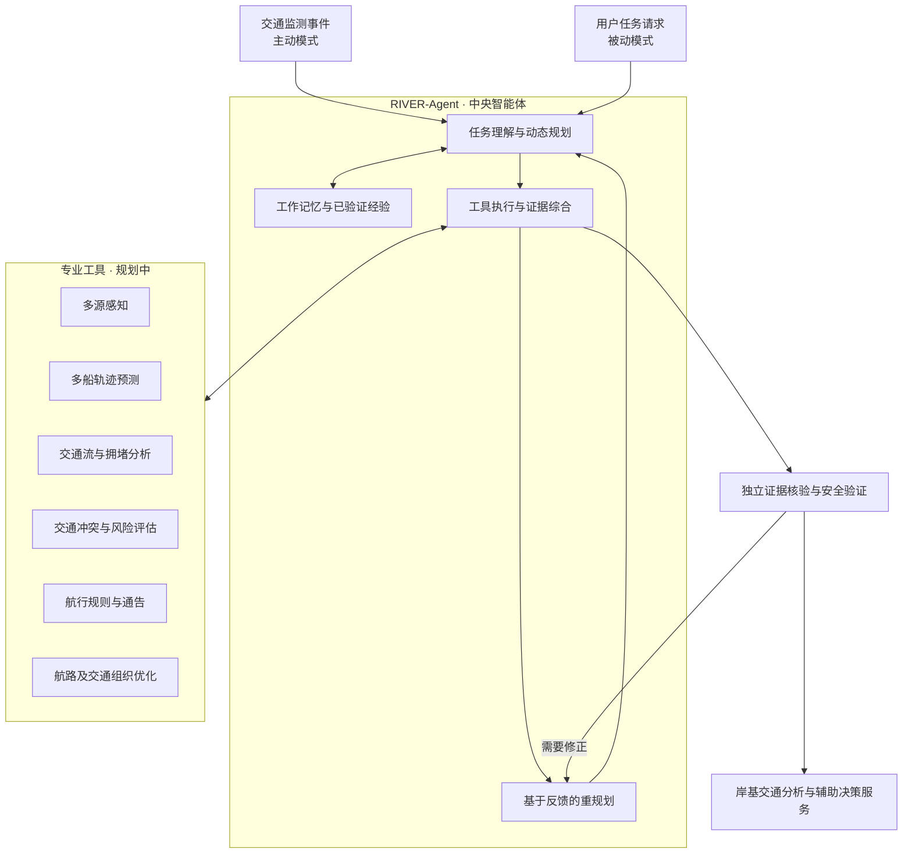

# RIVER-Agent

[English](README.md) | [简体中文](readme-zh.md)

### 面向内河航运的岸基智能体

**Reliable Inland Vessel Evidence-based Reasoning**

*感知 · 预测 · 评估 · 服务 · 协同*

[项目简介](#项目简介) · [总体架构](#总体架构) · [规划能力](#规划能力) · [开发路线](#开发路线) · [项目状态](#项目状态)

> [!NOTE]
> **项目状态：早期开发阶段。** 仓库正在初始化。下述架构和能力均为计划中的研究范围，**不代表相关功能已完成开发或性能已得到验证**。

## 项目简介

**RIVER-Agent** 是面向内河航运交通分析与智能航行辅助决策的岸基智能体研究项目。

项目旨在整合船舶观测、航道信息、交通预测、风险评估与航运专业工具。系统以**统一中央智能体**为核心，规划分析任务、调用专业工具、核验支撑证据，为船舶航行服务及区域交通管理提供可追溯的分析结果。

## 设计原则

- **统一中央智能体：** 由一个智能体负责规划与推理，专业能力通过工具提供，不预设多个独立 LLM Agent。
- **主动与被动融合：** 既支持监测事件触发，也支持用户主动提出任务。
- **规划 → 执行 → 验证 → 重规划：** 根据任务目标和已有证据动态选择工具、调整分析步骤。
- **基于证据的决策：** 数值预测、风险计算和安全校验由专业模块承担，与语言模型推理分离。
- **有限自主：** 为执行过程设置边界、故障处理机制，并对涉及航行安全的建议保留人工监督。
- **可追溯上下文：** 维护任务工作记忆，仅在适当验证后复用历史经验。

## 总体架构

中央智能体负责任务编排与推理。观测处理、预测、风险计算、优化和安全验证均作为可独立测试的专业能力模块。

## 规划能力

| 领域 | 计划实现的能力 |
| --- | --- |
| **交通态势感知** | 在数据条件允许时，接入 AIS、岸基雷达、北斗/GNSS、水文气象及航道基础设施状态等信息。 |
| **船舶轨迹预测** | 预测船舶短时轨迹，分析多船之间的交互关系。 |
| **交通态势演化** | 分析船舶交通流、拥堵状态、关键断面及复杂航段的交通变化。 |
| **风险评估** | 基于明确的计算依据识别潜在交通冲突、异常行为和航行风险。 |
| **航运知识检索** | 检索适用的航行规则、航行通告与通航限制，核对其时空有效性。 |
| **智能航行服务** | 支持单船风险信息服务、航路推荐及区域交通协同引导建议。 |

### 首个端到端应用场景

> 分析指定内河航段未来5分钟的潜在多船交通冲突，识别相关观测和预测依据，核对适用的通航限制，并输出有证据支撑的风险评估结果。

初期原型优先建设 **AIS 数据访问、航道信息查询、轨迹分析、风险计算及结果核验**。其他数据源与优化能力后续逐步接入。

## 开发路线

- [ ] **第一阶段 — Agent 核心：** 任务理解、动态规划、工具接口、执行状态、记忆、验证和异常恢复。
- [ ] **第二阶段 — 航运专业能力：** 多源感知、多船轨迹预测、交通流分析、风险评估和航运知识。
- [ ] **第三阶段 — 岸基智能服务：** 主动监测、单船个性化服务、航路与交通协同支持，以及典型航段验证。
- [ ] **科研验证：** 随系统能力逐步形成可复现任务基准、公平对照、鲁棒性分析与实证评价。

## 研究范围与安全边界

RIVER-Agent 定位于**科研与岸基辅助决策**，不能替代船舶驾驶人员或海事管理部门，不自主发布具有强制性的交通管制指令，也不直接操纵船舶。涉及航行安全的基础预警不应仅依赖 LLM 响应。

## 项目状态

项目目前处于**架构设计与初期开发阶段**。安装说明、可执行示例、数据集、Benchmark 结果、论文成果及发布信息将在实际具备并核实后补充。
